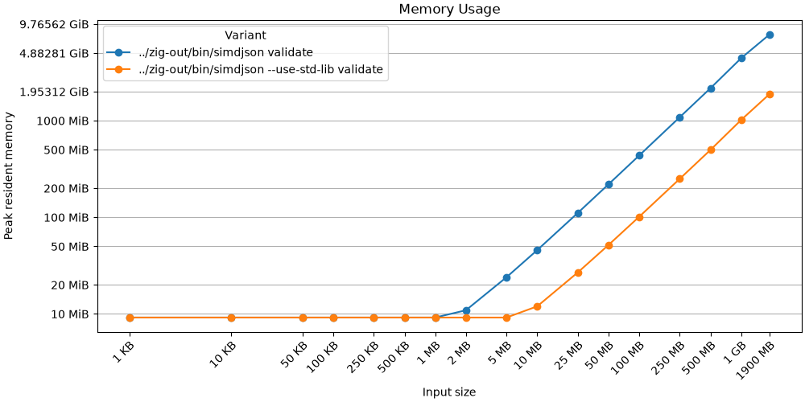
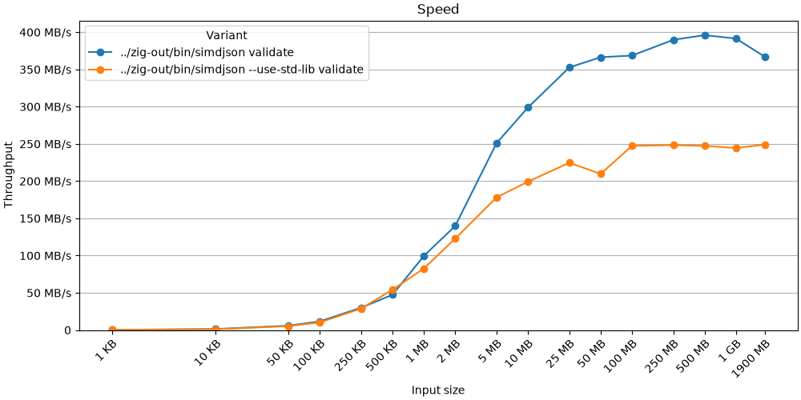
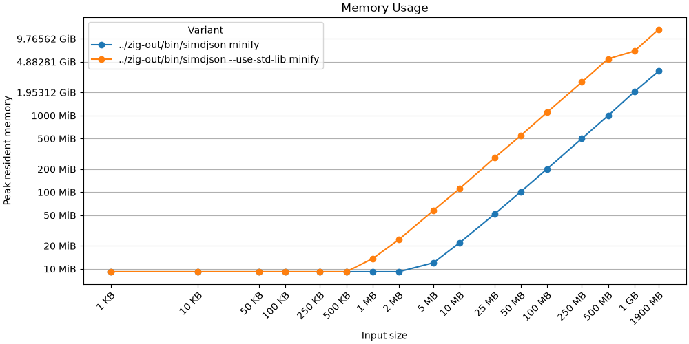
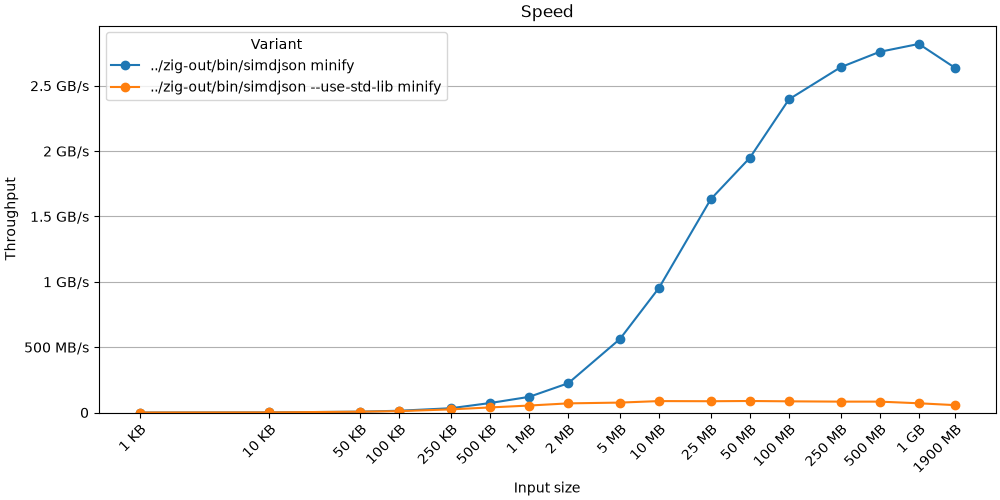
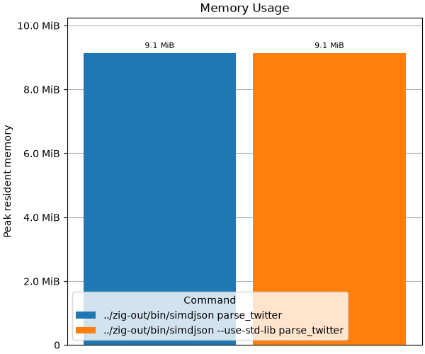
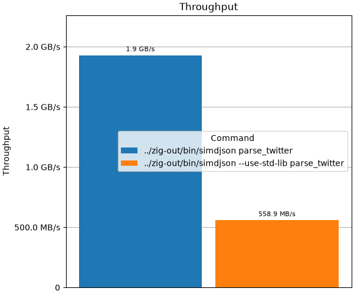

# simdjson-zig
Zig bindings to [simdjson](https://github.com/simdjson/simdjson/tree/master), a SIMD-accelerated JSON parser written in C++.

See the autogenerated [API docs](https://ephraimkunz.github.io/simdjson-zig/#docs.simdjson) for full documentation of the API surface.

## Quickstart
### Installation
Requires Zig 0.17.0 or newer.

```sh
zig fetch --save git+https://github.com/ephraimkunz/simdjson-zig#main
```
Then add to your `build.zig`:
```zig
const simdjson = b.dependency("simdjson", .{
    .target = target,
    .optimize = optimize,
});

exe.root_module.addImport("simdjson", simdjson.module("simdjson"));
```

### Hello World
```zig
const std = @import("std");
const sj = @import("simdjson");

pub fn main(init: std.process.Init) !void {
    const json =
        \\ { "name": "Jim Jones", "age": 32 }
    ;

    const Identity = struct { name: []u8, age: u8 };

    const parsed = try sj.parseFromSlice(Identity, init.gpa, json, .{});
    defer parsed.deinit();

    std.debug.print("Name: {s}, age: {d}\n", .{ parsed.value.name, parsed.value.age });
}
```

See the [examples](examples/) directory for more examples.

## Features
The library wraps simdjson version [5.3.0](https://github.com/simdjson/simdjson/releases/tag/v5.3.0).

Many simdjson features are supported:

| **simdjson feature** | **Supported in simdjson-zig** | **Notes** |
|---|---|---|
| [DOM parsing](https://github.com/simdjson/simdjson/blob/master/doc/dom.md) | ✅ | |
| [Bigint support](https://github.com/simdjson/simdjson/blob/master/doc/tape.md#big-integers) | ✅ | |
| [Minify](https://github.com/simdjson/simdjson/blob/master/doc/basics.md#minifying-json-strings-without-parsing) | ✅ |  |
| [UTF8 Validation](https://github.com/simdjson/simdjson/blob/master/doc/basics.md#utf-8-validation-alone) | ✅ |  |
| [Zero copy parsing](https://github.com/simdjson/simdjson/blob/master/doc/dom.md#parsing-without-padding) |  ✅ | The default in this library, but an option is provided for opting out. [simdjson docs](https://simdjson.github.io/simdjson/classsimdjson_1_1dom_1_1parser.html#a8a27c6955bc5b542890b2c4825ee917c) mark this API as experimental. |
| Ability to limit [maximum memory capacity](https://simdjson.github.io/simdjson/classsimdjson_1_1dom_1_1parser.html#a6977b4586bc601070cf100e2973a4cbc) and [maximum nesting depth](https://simdjson.github.io/simdjson/classsimdjson_1_1dom_1_1parser.html#ab090f596cd0b0c1d34576fd6aae88ee5) of parser | ✅ | |
| [OnDemand parsing](https://github.com/simdjson/simdjson/blob/master/doc/basics.md#the-basics-loading-and-parsing-json-documents) | ❌ | Supporting this would be difficult, see [Rust binding documentation](https://github.com/SunDoge/simdjson-rust#why-only-dom-not-ondemand) for an explanation of why. |
| [Generating JSON output](https://github.com/simdjson/simdjson/blob/master/doc/builder.md) | ❌ | Uses C++ specific features. |
| [Compile-time parsing](https://github.com/simdjson/simdjson/blob/master/doc/compile_time.md) | ❌ | Uses C++ specific features (and Zig does not allow calling across FFI boundaries at comptime). |
| Any other feature of simdjson | ❌ | Most of these require C++ specific features that we can't expose cleanly through a binding. Additional requests for specific feature support will be considered, however.  |

## API
The API can be split into two parts: (1) drop-in replacements for the Zig standard library JSON API, and (2) some additional SIMD-accelerated APIs provided by simdjson.

### Interoperability with Zig JSON APIs
This library strives to provide a drop-in replacement to the Zig standard library JSON API, allowing you to speed up JSON parsing without having to change much code.
The functions below have the same signatures and error sets as the `std.json` functions of the same name, so a call to one in the standard library can be replaced by a call to the other in simdjson-zig, or vice versa. The rest of `std.json` (`ParseOptions`, `Parsed`, `Value`, `Stringify`, etc) is not re-exported by simdjson-zig, so if you use them import both libraries and mix and match.

| **Zig standard library API** | **Identical API in simdjson-zig** | **Notes** |
|---|---|---|
| [parseFromSlice](https://ziglang.org/documentation/master/std/#std.json.static.parseFromSlice) | ✅ | Always behaves as if ParseOptions.allocate == .alloc_always, as it can't return references to the original slice due to the way simdjson works. |
| [parseFromSliceLeaky](https://ziglang.org/documentation/master/std/#std.json.static.parseFromSliceLeaky) | ✅ | Always behaves as if ParseOptions.allocate == .alloc_always, as it can't return references to the original slice due to the way simdjson works. |
| [validate](https://ziglang.org/documentation/master/std/#std.json.Scanner.validate) | ✅ |  |

The `TapeTokenSource` type can also be used directly or passed into any std.json functions that take a token source, such as [parseFromTokenSource](https://ziglang.org/documentation/master/std/#std.json.static.parseFromTokenSource) and [parseFromTokenSourceLeaky](https://ziglang.org/documentation/master/std/#std.json.static.parseFromTokenSourceLeaky).

The drop-in parsing functions use the same error sets as `std.json` to ensure API compatibility, but the specific errors returned for invalid input can differ
because the simdjson's parser detects errors at different stages from std.json's parser.

Numeric behavior follows simdjson's [tape](https://github.com/simdjson/simdjson/blob/master/doc/tape.md) representation. Decimal and exponent forms are converted to `f64` before conversion to the
requested Zig type, which can reduce precision or affect integer conversion, including when setting `parse_numbers = false` in [ParseOptions](https://ziglang.org/documentation/master/std/#std.json.static.ParseOptions). Numbers outside
the finite `f64` range may be rejected. Large integer literals without a decimal point or exponent are preserved as text through
[bigint](https://github.com/simdjson/simdjson/blob/master/doc/tape.md#big-integers) support. Original numeric spelling and negative zero are not always preserved.

#### Lifetimes
The lifetime of a parsed object depends on if alloc_always or alloc_if_needed is passed to ParseOptions.allocate. 

If alloc_if_needed is passed, the lifetime of a parsed object is tied to TapeParser. That means that a parsed object should not outlive the TapeParser that created it (the parser shouldn't be reused or deallocated while its objects are alive). This differs from std.json.Scanner / Reader's lifetime, which is tied to the input slice if alloc_if_needed is passed.

If alloc_always is passed, the lifetime of the parsed object is tied to the arena returned by std.json.Parsed.

`parseFromSlice` and `parseFromSliceLeaky` internally use a TapeParser instance that is allocated and deallocated before the functions return, so they force alloc_always internally.

Similar to std.json.Scanner/ Reader, simdjson-zig's TapeTokenSource should not be reused after a parse completes. Parsing the input slice is lazy: TapeTokenSource.init and TapeTokenSource.initWithParser only store the passed-in slice, and the document is parsed on the first token or peek. The input slice must not be freed or modified between init() and the end of parsing.

### Additional API
Additionally, the Zig binding adds new API for functionality simdjson exposes that the standard library doesn't:
* `pub fn minify(str: []const u8, out_buf: []u8) MinifyError![]u8` to minify JSON strings without parsing.
* `pub fn validateUTF8(str: []const u8) bool` to validate that a sequence of bytes are UTF-8 encoded.

## Performance
simdjson-zig performs at nearly double the speed of the Zig standard library JSON API, at the cost of using more memory. simdjson functions use more memory as it parses the entire JSON file in memory up front, instead of walking it on demand, in return for higher parsing speed.

The benchmarks below were all performed on an Apple M1 Pro with 32 GB RAM.

### Validating files of various sizes
This benchmark starts a new process, reads a JSON file from stdin into an in-memory buffer, validates it using either simdjson `validate` or standard library `validate`, and returns `true` or `false` depending on if it's valid to stdout.
Validate basically parses the entire JSON file and return an error if one was encountered during parsing. All JSON files tested are valid.
This benchmark is repeated across multiple files of various sizes. Because it involves process launch and teardown, reading from the filesystem, and allocating
memory, it's a more realistic example of how long it would take to read and parse a JSON file than a "hot loop" JSON parse microbenchmark (see below).




### Minifying files of various sizes
This benchmark has the same basic setup as the validate benchmark above, except that instead of validating JSON, it minifies the JSON read from stdin and outputs the minified JSON to stdout. Because the standard library doesn't have a minify function, this is implmented by parsing the JSON, then outputting it with the `.minified` option. As a result, the JSON is validated along the way. The simdjson minify implementation minifies without parsing or validating of the JSON, so it is expected to do much less work.




### Parsing JSON in a hot loop
This is a microbenchmark showing how fast JSON is parsed in a hot loop. It measures the cost of starting a new process, reading a JSON file from disk into an in-memory buffer (twitter.json), then parsing that JSON using parseFromTokenSource (so the TokenParser is reused between calls) into a struct 10,000 times back-to-back. While the GB/s number is likely to be higher than what you'd see in practice, it shows an upper bound on pure JSON parsing performance.




## How it works
simdjson parses a JSON document in two stages: stage1 scans the input with SIMD to find structural characters, and stage2 builds a [flat tape](https://github.com/simdjson/simdjson/blob/master/doc/tape.md). This tape is an array of 64-bit words encoding every value with its type tag and payload, plus a side string buffer holding all (already-unescaped) string bytes.

This package, similar to the [Rust simdjson binding](https://github.com/SunDoge/simdjson-rust), exposes that tape through a C wrapper around the original simdjson C++ code (since Zig can't bind natively to C++), then implements higher-level functionality to walk it in Zig. This allows us to minimize the FFI crossings for efficiency, reuse parsing code in the std library, and provide a familiar API shape and drop-in replacement capabilities, all on top of a simd-accelerated backend.

## Local development
* `./build_and_view_docs.sh`: Generate documentation and open a local webpage to browse docs
* `zig build test`: Run unit tests
* `zig build test --fuzz`: Run the fuzz tests
* `zig build run`: Run the CLI, which has subcommands for minifying, validating, and parsing twitter.json
* `zig build run-<example filename>`: Run the example file
* `cd benchmarking && ./benchmark.sh`: Runs the benchmark and generates the graphs for the README performance section
